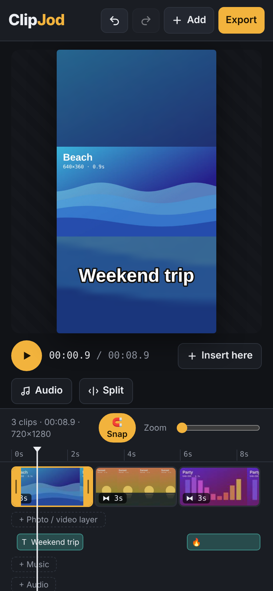

# ClipJod

A free video editor for your phone and browser. Join clips, cut out parts, add text, music and transitions, then export one MP4. No watermark, no account, and your videos never leave your device.

<p align="center"></p>

## Get the app

- **Android:** open the [latest release](../../releases/latest) on your phone and download `ClipJod.apk`. Open it to install. The first time, Android asks you to allow installs from your browser or file manager.
- **Any phone or computer (web app):** open the GitHub Pages link shown in the repository's *About* box. On Android Chrome tap ⋮ → *Add to Home screen*; on iPhone Safari tap Share → *Add to Home Screen*.

### Urdu mein

1. Phone par is page ke **Releases** mein jayein aur `ClipJod.apk` download karein.
2. File kholein aur **Install** dabayein. Pehli dafa Android "unknown apps" ki ijazat maangega, de dein.
3. App kholein, **Add** dabayein aur videos chunein. Kaam ke baad **Export → Save to phone** ya **Share**.

## What it does

| Area | Features |
| --- | --- |
| Clips | Join videos and photos, trim by dragging the edges, split, cut out a middle part, insert at the playhead, reorder, freeze frame |
| Speed | 0.1×–8×, speed curves (Montage, Hero, Bullet, Jump cut, Flash in/out, custom) |
| Look | Filters, brightness/contrast/saturation, temperature, tint, hue, fade, effects (VHS, grain, vignette, cinema bars), crop/zoom/pan |
| Motion | Keyframe animation for clips, layers and text, 9 transitions |
| Layers | Picture-in-picture photos and videos, masks (circle, heart, star), green screen, fill/stretch, drag to resize and lengthen |
| Text | Fonts including Urdu Nastaliq, outline/shadow/box, animations, stickers, captions from a script, auto captions (Whisper, on device) |
| Sound | Music with loop and fade, beat detection and "cut on the beat", voice-over recording, extra audio tracks with trimming, mute, fades, remove silences |
| Export | MP4 (or WebM) at 480p/720p/1080p, 24/30/60 fps, 9:16, 1:1, 4:5, 16:9 |
| Workflow | Undo/redo, snapping, auto-save drafts |

Auto captions download a speech model (40–80 MB) the first time and need internet for that step.

## How it is built

- `www/index.html` is the whole editor: plain HTML, CSS and JavaScript, no build step. Video is drawn on a canvas and recorded with `MediaRecorder`; sound is mixed with the Web Audio API.
- `android/` is a [Capacitor](https://capacitorjs.com) project that wraps the editor in an Android app. Exports are saved with the Filesystem plugin and shared with the Share plugin.
- `www/manifest.webmanifest` and `www/sw.js` make the web version installable and usable offline.

### Build it yourself

```bash
npm ci
npx cap sync android
cd android && ./gradlew assembleDebug   # needs JDK 21 and the Android SDK
```

The APK lands in `android/app/build/outputs/apk/debug/`. To try the web version locally: `npm run serve` and open http://localhost:8080.

### Automatic builds

Every push to `main` runs two GitHub Actions workflows:

- **Build Android app** builds the APK and publishes it as a new release. If the repository has the secrets `CLIPJOD_KEYSTORE_B64`, `CLIPJOD_STORE_PASSWORD`, `CLIPJOD_KEY_ALIAS` and `CLIPJOD_KEY_PASSWORD`, the APK is signed with that key. Without them it builds a debug APK signed with `android/app/clipjod-debug.keystore`, which is kept in the repo so each new build installs over the previous one. For a Play Store release, create your own private key and add the secrets above.
- **Publish web app** deploys `www/` to GitHub Pages.
